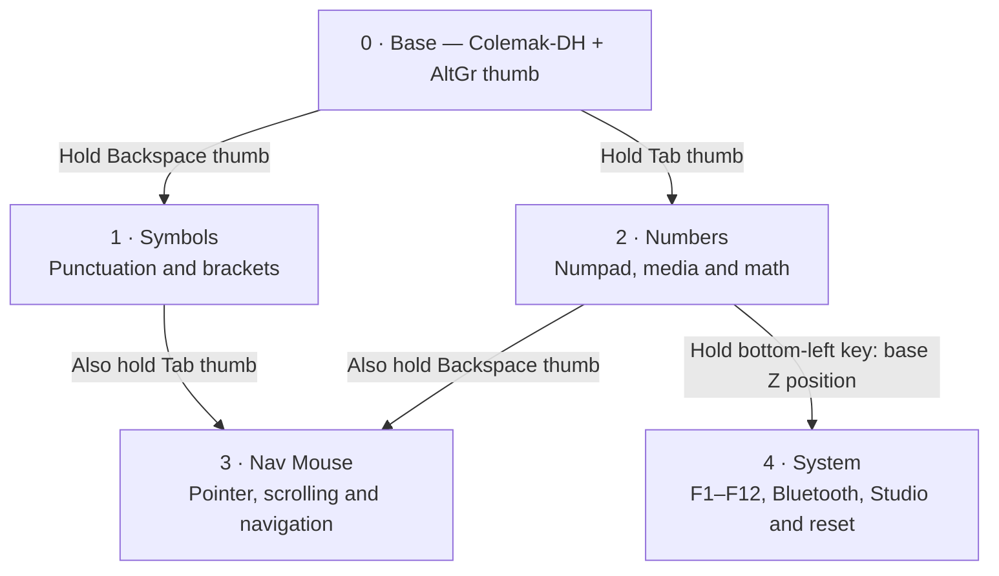

# Sweep layer guide

Adapted from [Ben Vallack's reference keymap](https://raw.githubusercontent.com/benvallack/zmk-config/84ae125986b18e1e6dfb1f2a6a15777429f29520/config/cradio.keymap).
Your existing base letter positions, home-row modifiers, their hold-tap timings
and mouse acceleration remain unchanged. Base thumb keys, left to right:
Tab (hold Numbers), Enter, Space (hold AltGr), Backspace (hold Symbols).



All layer access is momentary. Release the layer keys to return to Base.
From Nav Mouse, releasing Tab leaves Symbols; releasing Backspace leaves
Numbers. Releasing both leaves Base. From System, release Z to return to
Numbers; release both Z and Tab to return to Base. There are no latched layers.
Nav Mouse is activated only by the existing conditional-layer mechanism.

## What changed from the reference

- Base is your Colemak-DH layout, not the reference alphabet or thumb layout.
- Symbols and Numbers retain the reference's separation and right-hand numpad.
- Layer switching uses your existing thumb holds rather than the reference's
  persistent `to` transitions. No new tap-dance timing is introduced.
- Symbols use ordinary US-layout punctuation instead of macOS Option shortcuts.
- Navigation keeps the mouse cluster on the left and keyboard navigation on
  the right. Ctrl+Shift+Tab / Ctrl+Tab switch tabs where the application supports
  them; Ctrl+[ / Ctrl+] are application-dependent shortcuts.
- The reference's Bluetooth layer is extended to System, retaining your
  Studio unlock, profile selection, reset and bootloader access, plus F1–F12.
- Deprecated mouse/scroll bindings are replaced with your existing modern
  `mmv`, `msc`, and `mkp` behaviors.

## Reading the layouts

Each of the first three rows has five left keys, then five right keys.
The final row lists the four thumbs from left to right. `trans` falls through
to the underlying layer. In the new layers, thumbs remain transparent so
layer-key releases and the existing Enter/Space keys continue to work.
`mo SYSTEM` means hold this key for System. Modifiers such as `LC(...)` mean
hold Left Ctrl with that key. Symbols assume a US host keyboard layout.

## 1 · Symbols — hold Backspace

```text
ESC               AT                HASH              DLLR              PRCNT             | CARET             LT                GT                SEMI              BSPC             
TAB               EQUAL             LBKT              RBKT              SQT               | BSLH              LBRC              RBRC              PIPE              ENTER            
TILDE             GRAVE             PLUS              MINUS             DQT               | AMPS              LPAR              RPAR              UNDER             EXCL             
Thumbs: trans | trans | trans | trans
```

## 2 · Numbers — hold Tab

```text
ESC               C_PP              C_PREV            C_NEXT            UNDER             | MINUS             N7                N8                N9                trans            
TAB               C_MUTE            C_VOL_DN          C_VOL_UP          PLUS              | EQUAL             N4                N5                N6                ENTER            
mo SYSTEM         AMPS              FSLH              ASTRK             DOT               | N0                N1                N2                N3                COMMA            
Thumbs: trans | trans | trans | trans
```

## 3 · Nav Mouse — hold Tab + Backspace

```text
ESC               msc SCRL_LEFT     mmv MOVE_UP       msc SCRL_RIGHT    F5                | LC(LBKT)          LC(LS(TAB))       LC(TAB)           LC(RBKT)          BSPC             
F1                mmv MOVE_LEFT     mmv MOVE_DOWN     mmv MOVE_RIGHT    DEL               | LEFT              DOWN              UP                RIGHT             ENTER            
caps_word         mkp MB2           msc SCRL_UP       msc SCRL_DOWN     mkp MB3           | mkp MB1           PG_DN             PG_UP             HOME              END              
Thumbs: trans | trans | trans | trans
```

## 4 · System — hold Tab, then base Z

```text
F1                F2                F3                F4                bt BT_SEL 0       | F5                F6                F7                F8                F9               
F10               F11               F12               trans             bt BT_SEL 1       | trans             trans             trans             trans             trans            
trans             bt BT_PRV         bt BT_NXT         bt BT_CLR         bt BT_SEL 2       | studio_unlock     trans             trans             sys_reset         bootloader       
Thumbs: trans | trans | trans | trans
```

In System, Bluetooth profile 0/1/2 selects channels 1/2/3 on the display.
`BT_PRV` / `BT_NXT` cycle profiles; `BT_CLR` clears the selected profile's bond.
Reset restarts the dongle; Bootloader enters flashing mode.

## Validation

Static validation checks that all five layers contain 34 bindings, the base
letter bindings and home-row behavior match the previous version, all referenced layers
exist, and layer-hold positions remain transparent on overlays. Keycode names
are checked against the current official ZMK headers. A firmware build and
on-device typing check are still required: this machine has no west/Zephyr SDK.
The existing build matrix and hardware configuration are unchanged.

If ZMK Studio has a saved runtime keymap, its stored settings may override
this compiled keymap; reset the Studio keymap to firmware defaults to use it.

## Spanish typing with the right thumb

Tap the inner right thumb for Space; hold it for Right Alt (AltGr), then press
another key. It uses a separate hold-preferred behavior (200 ms tapping term,
150 ms quick-tap for repeated spaces), so it can become AltGr immediately when
you chord another key. The other right thumb still taps Backspace/holds Symbols.
All upper layers inherit this thumb through their transparent bindings.

Firmware sends Right Alt plus the key; your host keyboard layout determines the
result. AltGr + A/E/I/O/U can produce accented vowels and AltGr + N can produce
ñ only if your host layout defines those combinations. Plain US does not.
You confirmed Windows with a Colemak host layout. Standard Colemak supports
AltGr + A/E/I/O/U for á/é/í/ó/ú and AltGr + N for ñ, as documented at
https://colemak.com/Multilingual. These characters are not generated by firmware
Unicode macros. Since the firmware already rearranges letters into
Colemak-DH, a host Colemak layout can rearrange them a second time. Keep your
currently working letter layout and confirm its AltGr mappings before changing
host layouts. Test these shortcuts after flashing; the actual letters still depend on which
layout Windows applies to the incoming keycodes.
