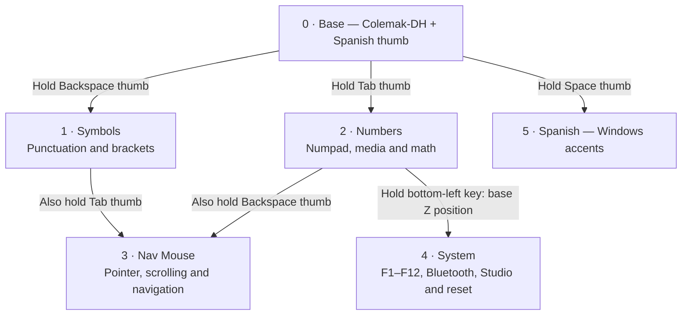

# Sweep layer guide

Adapted from [Ben Vallack's reference keymap](https://raw.githubusercontent.com/benvallack/zmk-config/84ae125986b18e1e6dfb1f2a6a15777429f29520/config/cradio.keymap).
Your existing base letter positions, home-row modifiers, their hold-tap timings
and mouse acceleration remain unchanged. Base thumb keys, left to right:
Tab (hold Numbers), Enter, Space (hold Spanish), Backspace (hold Symbols).



All layer access is momentary. Release the layer keys to return to Base.
From Nav Mouse, releasing Tab leaves Symbols; releasing Backspace leaves
Numbers. Releasing both leaves Base. From System, release Z to return to
Numbers; release both Z and Tab to return to Base. There are no latched layers.
Nav Mouse is activated only by the existing conditional-layer mechanism.

## What changed from the reference

- Base is your Colemak-DH layout, not the reference alphabet or thumb layout.
- Symbols and Numbers retain the reference's separation and right-hand numpad.
- Layer switching uses your existing thumb holds rather than the reference's
  persistent `to` transitions. No new tap-dance timing is introduced.
- Symbols use ordinary US-layout punctuation instead of macOS Option shortcuts.
- Navigation keeps the mouse cluster on the left and keyboard navigation on
  the right. Ctrl+Shift+Tab / Ctrl+Tab switch tabs where the application supports
  them; Ctrl+[ / Ctrl+] are application-dependent shortcuts.
- The reference's Bluetooth layer is extended to System, retaining your
  Studio unlock, profile selection, reset and bootloader access, plus F1–F12.
- Deprecated mouse/scroll bindings are replaced with your existing modern
  `mmv`, `msc`, and `mkp` behaviors.

## Reading the layouts

Each of the first three rows has five left keys, then five right keys.
The final row lists the four thumbs from left to right. `trans` falls through
to the underlying layer. In the new layers, thumbs remain transparent so
layer-key releases and the existing Enter/Space keys continue to work.
`mo SYSTEM` means hold this key for System. Modifiers such as `LC(...)` mean
hold Left Ctrl with that key. Symbols assume a US host keyboard layout.

## 1 · Symbols — hold Backspace

```text
ESC               AT                HASH              DLLR              PRCNT             | CARET             LT                GT                SEMI              BSPC
TAB               EQUAL             LBKT              RBKT              SQT               | BSLH              LBRC              RBRC              PIPE              ENTER
TILDE             GRAVE             PLUS              MINUS             DQT               | AMPS              LPAR              RPAR              UNDER             EXCL
Thumbs: trans | trans | trans | trans
```

## 2 · Numbers — hold Tab

```text
ESC               C_PP              C_PREV            C_NEXT            UNDER             | MINUS             N7                N8                N9                trans
TAB               C_MUTE            C_VOL_DN          C_VOL_UP          PLUS              | EQUAL             N4                N5                N6                ENTER
mo SYSTEM         AMPS              FSLH              ASTRK             DOT               | N0                N1                N2                N3                COMMA
Thumbs: trans | trans | trans | trans
```

## 3 · Nav Mouse — hold Tab + Backspace

```text
ESC               msc SCRL_LEFT     mmv MOVE_UP       msc SCRL_RIGHT    F5                | LC(LBKT)          LC(LS(TAB))       LC(TAB)           LC(RBKT)          BSPC
F1                mmv MOVE_LEFT     mmv MOVE_DOWN     mmv MOVE_RIGHT    DEL               | LEFT              DOWN              UP                RIGHT             ENTER
caps_word         mkp MB2           msc SCRL_UP       msc SCRL_DOWN     mkp MB3           | mkp MB1           PG_DN             PG_UP             HOME              END
Thumbs: trans | trans | trans | trans
```

## 4 · System — hold Tab, then base Z

```text
F1   F2      F3      F4      BT1 | F5      F6      F7      F8     F9
F10  F11     F12     NumLock BT2 | USB     BLE     Toggle  trans  trans
trans BTprev BTnext  BTclear BT3 | Studio  trans   trans   Reset  Boot
              trans trans       | trans   trans
```

Output keys are on the right home row: base H selects USB, base N selects
Bluetooth, base E toggles. USB can remain plugged in while typing over BLE.
Select BT1/BT2/BT3 to choose the Bluetooth host as well as selecting BLE output.
This selects one active destination, not simultaneous typing to two hosts.
Num Lock is at the base T position. Check Windows' Num Lock state; pressing
this key toggles it, rather than guaranteeing it is on.

In System, Bluetooth profile 0/1/2 selects channels 1/2/3 on the display.
`BT_PRV` / `BT_NXT` cycle profiles; `BT_CLR` clears the selected profile's bond.
Reset restarts the dongle; Bootloader enters flashing mode.

## Validation

Static validation checks that all six layers contain 34 bindings, the base
letter bindings and home-row behavior match the previous version, all referenced layers
exist, and layer-hold positions remain transparent on overlays. Keycode names
are checked against the current official ZMK headers. A firmware build and
on-device typing check are still required: this machine has no west/Zephyr SDK.
The existing build matrix and hardware configuration are unchanged.

If ZMK Studio has a saved runtime keymap, its stored settings may override
this compiled keymap; reset the Studio keymap to firmware defaults to use it.

## 5 · Spanish — hold the Space thumb (Windows)

Space still types a space on tap. Holding it now activates a Spanish layer,
not Right Alt. Your existing home-row Right Alt (hold base I) is retained.
The thumb uses hold-preferred behavior with quick-tap disabled, allowing an
accent chord immediately after typing a space. All base letter taps and other
layer-entry bindings remain unchanged.

```text
Á      É      Í      Ó      Ú   | Ñ      trans  ú      trans  trans
á      trans  trans  trans  trans | trans  ñ      é      í      ó
trans  trans  trans  trans  trans | trans  trans  trans  trans  trans
                    trans trans | trans  trans
```

For lowercase accents, hold Space and tap the usual base A/E/I/O/U/N positions.
Uppercase accents are dedicated keys on the first six positions of the top row
(base Q/W/F/P/G/J). Use those keys without Shift; other held modifiers can
interfere with Windows Alt-number entry.

`config/spanish.dtsi` defines bounded macros that press Left Alt, tap four
numeric-keypad digits (including a leading zero), and release Alt. Values are
Windows-1252: á 0225, é 0233, í 0237, ó 0243, ú 0250, ñ 0241; uppercase
Á 0193, É 0201, Í 0205, Ó 0211, Ú 0218, Ñ 0209. Each macro takes roughly
100 ms; complete one accent before starting the next.

Prerequisites: Num Lock on, a Windows Western European ANSI code page, and an
application that supports Alt-number input. This avoids dependence on AltGr
letter mappings, but is not a universal Unicode input method. Other code pages,
Windows UTF-8 legacy mode or applications may behave differently. It does not
provide accents on Android/iOS/macOS/Linux. Plain base typing and USB/BLE output
selection remain available on those hosts.

Test after flashing: open Notepad, enable Num Lock, hold Space and tap A/E/I/O/U/N
one at a time. Expect áéíóúñ. Then test the uppercase top-row keys. Do not change
your Windows layout as part of this test.

References: [Windows Alt-number input](https://support.microsoft.com/en-us/word/insert-ascii-or-unicode-latin-based-symbols-and-characters),
[ZMK macros](https://zmk.dev/docs/keymaps/behaviors/macros),
[ZMK output selection](https://zmk.dev/docs/keymaps/behaviors/outputs).
